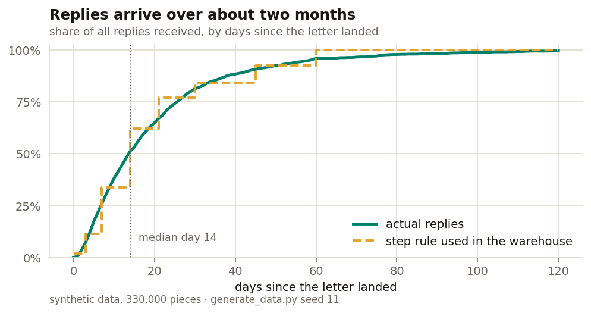
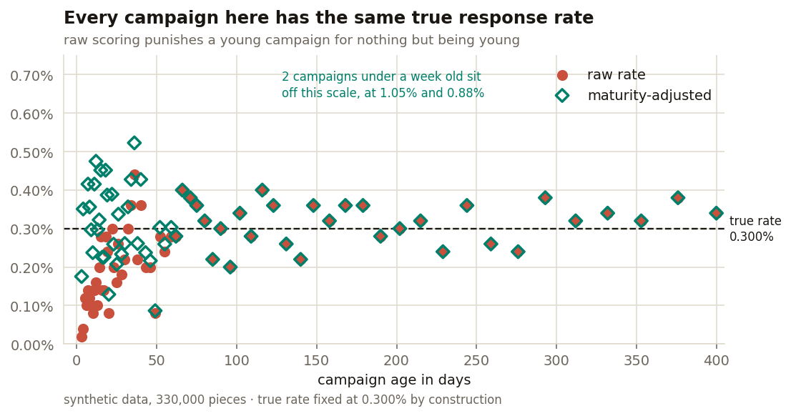

# A response rate you can read before the responses have arrived

**Direct mail replies arrive over about two months. If you score a campaign on the raw rate before that window has passed, every recent campaign looks like a failure — and the newer it is, the worse it looks.** Weighting each piece by how much of its response window has actually elapsed removes the bias. On data where I set the true rate myself, raw scoring reads campaigns under three weeks old at **0.138%** when the truth is **0.300%**. The adjusted measure reads them at **0.347%**.

---

## The problem

A letter lands. Some people call that week. Some call six weeks later, after the house is cleared or the paperwork comes through. Half the replies are in by day 14, but it takes about 60 days for the last of them.

So on any given Monday your newest campaign has had almost none of its chances yet. Score it against a campaign from last year and it looks terrible. That is not a finding about the campaign — it is a finding about when you looked.

The usual workaround is to ignore anything under 60 days. That throws away the only campaigns you can still do something about.

## The approach

Instead of counting pieces in the denominator, count **response windows elapsed**.

A piece that landed 90 days ago has had its full chance, so it counts as 1. A piece that landed 3 days ago has had almost none, so it counts as 0.02. The weights come from reading the observed response curve.



The dashed line is the step function the warehouse actually uses. It is deliberately coarser than the underlying curve, because it has to live in a SQL computed column and re-evaluate on every read — nobody wants a lognormal CDF in T-SQL. The approximation costs very little and buys a measure that updates itself overnight with nothing to rerun.

```
adjusted rate  =  replies  /  Σ (expected_response_pct per piece)
```

## Does it work?

On real data you can never check, because you never know the true rate. So I generated the data instead, and **set every campaign to the same true rate of 0.300%**. Any difference the scoring shows between campaigns is therefore pure measurement artefact — there is nothing real to find.



| campaigns | raw rate | adjusted rate |
|---|---|---|
| under 21 days old | 0.138% | 0.347% |
| 60 days or more | 0.316% | 0.316% |
| all 66 | 0.251% | 0.315% |

*true rate, fixed by the generator: 0.300%*

Raw scoring reads young campaigns at **less than half** their real rate. The adjustment puts them back in the right neighbourhood. For mature campaigns the two agree exactly, which is the sanity check — once the window has fully elapsed the weight is 1 and the adjustment does nothing.

## What it costs

**The adjustment removes a bias and adds variance.** Dividing by a small denominator magnifies noise, so a very young campaign gets an unstable estimate rather than a reliably wrong one. In this run the spread across campaigns was about the same either way — the adjusted numbers are centred correctly but scattered.

Two campaigns under a week old came out at 0.88% and 1.05%, three times the truth. The honest reading is that **below about a week the adjustment should not be trusted either** — there is simply not enough signal yet. What it buys you is the range from roughly one week to two months, which is where decisions actually get made.

It also does nothing about the real limit: with response rates in the tenths of a percent, a single campaign of a few thousand pieces has only a handful of expected replies. No amount of weighting creates statistical power that was never there.

## What I would do differently

- **Fit the curve instead of stepping it.** The step function was chosen so it could sit in a computed column. A fitted distribution would weight more precisely, at the cost of having to recompute it somewhere.
- **Put a confidence interval next to the rate.** The adjusted rate is a point estimate with wide uncertainty on young campaigns, and showing it alone invites people to read differences that are not there.
- **Shrink young campaigns toward the baseline.** An empirical-Bayes estimate would stop a one-week-old campaign reporting 1.05% off three replies.

## Running it

```bash
pip install numpy pandas matplotlib
python generate_data.py     # writes data/campaigns.csv and data/replies.csv
python analysis.py          # writes both charts, prints the table above
```

Seeded, so it reproduces exactly.

```
sql/maturity_columns.sql    the computed columns and the side-by-side query
dax/measures.dax            the same logic as a semantic model
```

## A note on the data

Every number here is synthetic, from `generate_data.py`. The technique comes from production work on a direct-mail programme; the data does not, and none of that client's figures appear anywhere in this repository.
