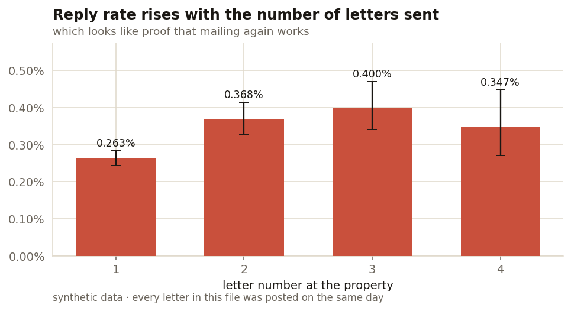
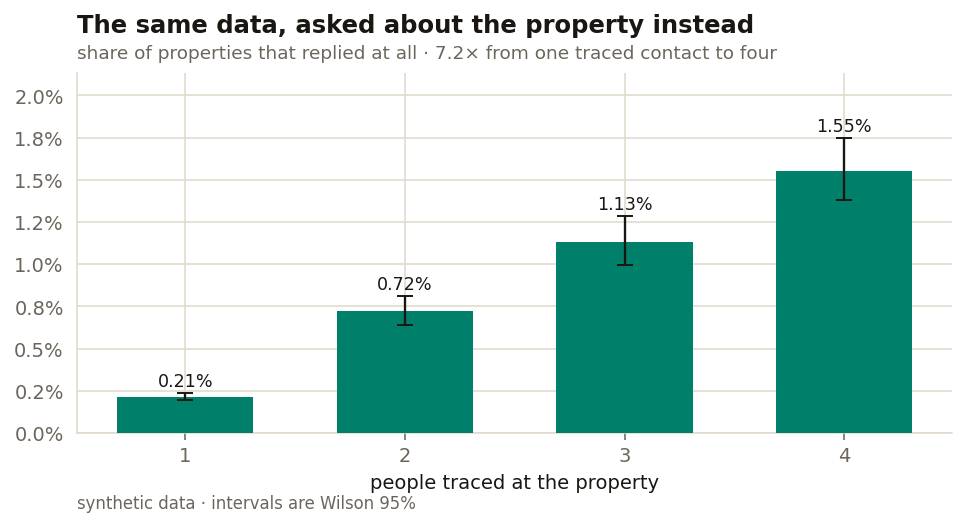

# A statistically significant finding that cannot possibly be true

**Reply rate rises from 0.263% on the first letter to 0.400% on the third. The confidence intervals don't overlap. It reads as clear evidence that mailing a property again works — and it is impossible, because every letter in this dataset was posted on the same day.**

There are no second touches anywhere in the file. Not one property is ever mailed twice in time. Whatever that rising ladder is, it is not a touch effect.

---

## The trap



| letter | letters | replies | rate | 95% CI |
|---|---|---|---|---|
| 1 | 250,000 | 658 | 0.263% | 0.244–0.284% |
| 2 | 75,184 | 277 | 0.368% | 0.328–0.414% |
| 3 | 37,272 | 149 | 0.400% | 0.341–0.469% |
| 4 | 17,271 | 60 | 0.347% | 0.270–0.447% |

Letter 1 against letter 2 is a clean separation. If you wanted a case for a re-mail budget, this is what you would put on the slide.

**It would be wrong, and significance testing offers no protection at all.** The difference is genuinely there in the data. It is the causal reading that is broken.

## What `letter_no` is actually counting

It counts **people at an address**, not contacts over time.

A property going through an estate process might have one traceable heir or it might have four. Each gets a letter, all in the same drop. Numbering them 1, 2, 3, 4 creates a column that looks like a sequence and is really a headcount.

That changes who is in each bucket. **Letter 1 contains every property in the dataset.** Letter 4 contains only the properties where four people were traced — and those are different properties. More reachable, better records, a more active estate. They respond better per letter for reasons that have nothing to do with being mailed again.

So the ladder is composition. Each rung is a more selective sample than the one below it.

## Asking the property instead



| people traced | properties | replied | rate | 95% CI |
|---|---|---|---|---|
| 1 | 174,816 | 375 | 0.215% | 0.194–0.237% |
| 2 | 37,912 | 273 | 0.720% | 0.640–0.810% |
| 3 | 20,001 | 226 | 1.130% | 0.993–1.286% |
| 4 | 17,271 | 268 | 1.552% | 1.378–1.747% |

**A property where four people were traced is 7.2× more likely to reply than one where a single person was.** Intervals nowhere near each other.

Two separate things are driving that. Letters to multi-contact properties do a little better each — and a property with four letters gets four independent chances. Compounding does most of the work, which is why the property-level gap (7.2×) is so much larger than the per-letter gap.

## The check that settles it

Hold the number of contacts fixed and look at letter number inside each group. If a later letter were doing anything, the rate would climb left to right within a row.

```
                    letter 1   letter 2   letter 3   letter 4
1 contact traced      0.215%          -          -          -
2 contacts traced     0.377%     0.343%          -          -
3 contacts traced     0.355%     0.395%     0.380%          -
4 contacts traced     0.400%     0.394%     0.423%     0.347%
```

Flat. Every row. There is no touch effect because there are no touches — exactly as the generator was built.

**The aggregate ladder and the within-group flatness come from the same 379,727 letters.** One of them is an artefact of how the rows were bucketed. That is a unit-of-analysis error: the question was about properties and the measurement was per letter.

## What this changes

The conclusions point in opposite directions and so does the money.

*Mail them again* — a repeat-mail budget, chasing an effect the data cannot support.

*Trace more people per property* — skip-tracing depth, which is the thing actually associated with a reply, and which is cheaper than a second print run.

## How to catch it

- **Ask what one row is.** A rate per letter answers a question about letters. If the question was about properties, the denominator is wrong before any statistics happen.
- **Check the variable means what its name says.** One `SELECT` on the gap between a property's first and last mail date would have ended this in a minute.
- **Look for the group that changes composition.** When a bucket's membership shifts as you move along the axis, you are comparing different populations.
- **Stratify before believing it.** Holding the suspected confounder fixed is the cheapest test there is.

## What I would do differently

- **Model it rather than tabulate it.** A logistic regression at property level with contacts-traced as a covariate would give an effect size with the confounder adjusted rather than just shown.
- **Separate reachability from estate activity.** "More people traced" bundles two things — better data and a more active estate. They have different operational responses and this design can't tell them apart.
- **Make the trap impossible instead of detectable.** Rename the column `contact_index` and no one reads it as a sequence. Most of these errors are naming, not statistics.

## Running it

```bash
pip install numpy pandas matplotlib scipy
python generate_data.py     # writes data/letters.csv and data/properties.csv
python analysis.py          # writes both charts, prints every table above
```

Seeded, so it reproduces exactly. The generator sets per-letter reply probability from the property's contact count and **never** from the letter number, and stamps one single mail date on all 379,727 rows.

## A note on the data

All synthetic. The pattern is one I ran into on a live direct-mail programme; the data is not that client's and none of their figures appear here.
